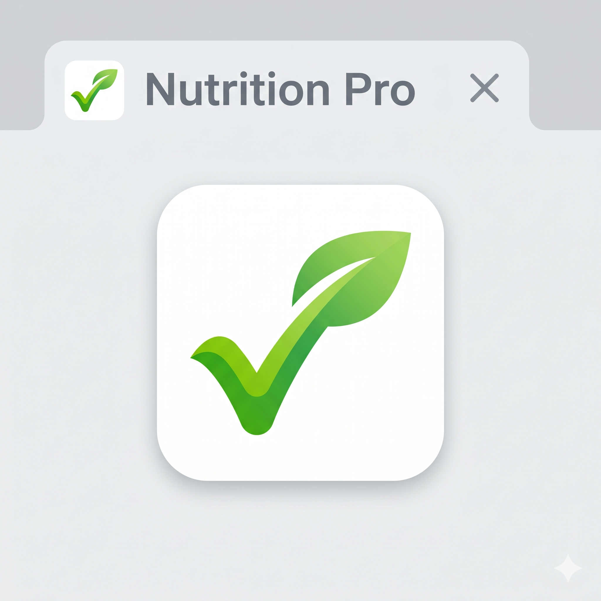
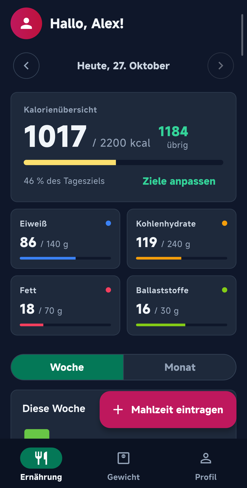
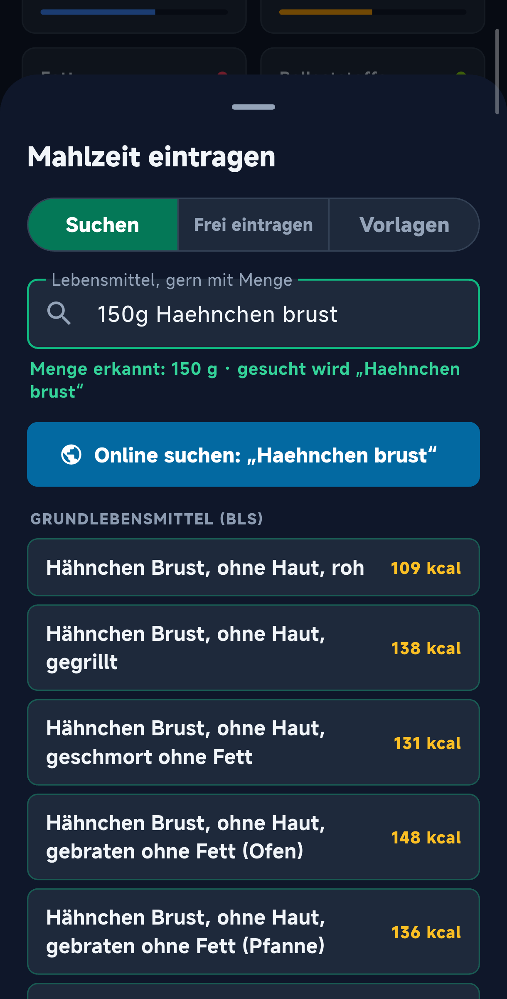
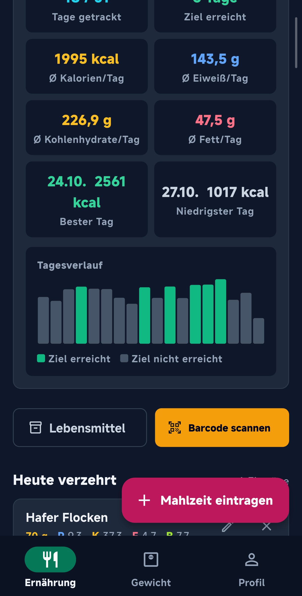
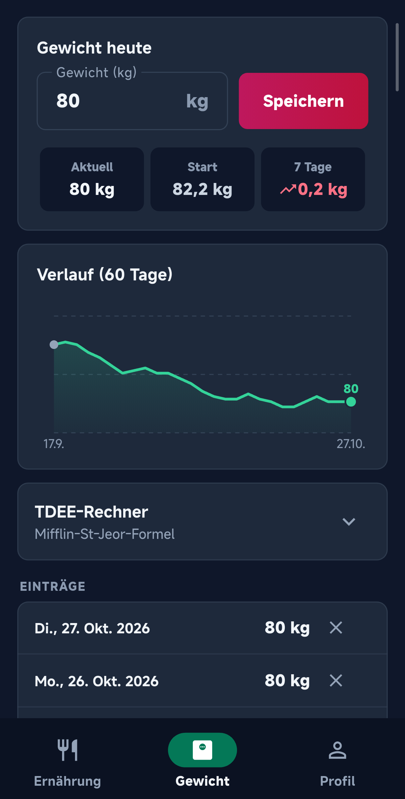

<a href="README.md">English</a> · <b>Deutsch</b>

<h1 align="center">MacroBandit</h1>

  Kostenloser, werbefreier Makro- &amp; Kalorien-Tracker für Android. 
  Funktioniert offline, ohne Konto, alle Daten bleiben auf deinem Handy.

  
  
  
  

---

## Funktionen

- **Kein Konto, kein Server** – alles wird auf dem Gerät gespeichert (SQLite)
- **Schnelleingabe** wie `200g Milch 3,5` – Menge wird erkannt, Kalorien und Makros sofort berechnet
- **7 140 Grundlebensmittel offline** aus dem Bundeslebensmittelschlüssel BLS 4.0 (Max Rubner-Institut)
- **Barcode-Scanner** (zxing, ohne Google-Dienste) und Online-Suche – Produktdaten von Open Food Facts; der einzige Netzzugriff, nur auf Anfrage
- **Eigene Lebensmittel & Vorlagen** – Favoriten und ganze Mahlzeiten speichern, mit einem Tipp eintragen
- **Wochen- & Monatsstatistik** – Summen, Durchschnitte, erreichte Ziele
- **Gewichts-Tracker** mit Verlauf und 7-Tage-Trend
- **TDEE-Rechner** (Mifflin-St-Jeor) – Ergebnis als Kalorienziel übernehmen
- **Sicherung & Wiederherstellung** als JSON-Datei, CSV-Export
- Deutsch & Englisch, helles & dunkles Design

## Download

Signierte APKs gibt es auf der [Release-Seite](https://github.com/CrashBandit82/macrobandit/releases)
(`arm64-v8a` passt für fast alle aktuellen Handys). Eine F-Droid-Veröffentlichung ist in Arbeit.

## Bauen

Die App liegt in [`app/`](app/) – siehe [app/README.md](app/README.md).

## Datenquellen

- Max Rubner-Institut (2025): Bundeslebensmittelschlüssel (BLS), Version 4.0 – Deutsche Nährstoffdatenbank. Karlsruhe. DOI: [10.25826/Data20251217-134202-0](https://doi.org/10.25826/Data20251217-134202-0) – frei nutzbar, auch für App-Entwicklung.
- [Open Food Facts](https://de.openfoodfacts.org) – Open Database License (ODbL).

## Lizenz

[GNU AGPL-3.0](LICENSE) – © CrashBandit82
